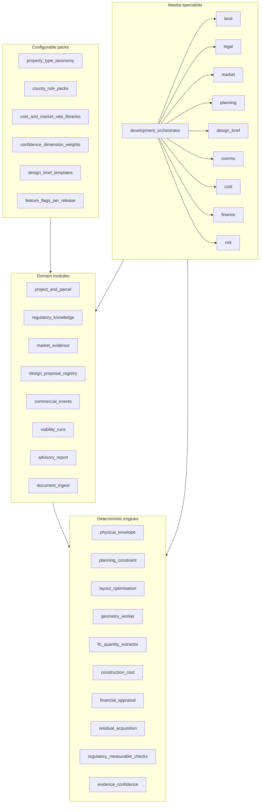
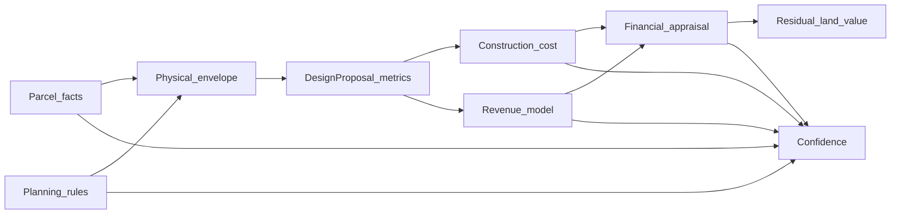
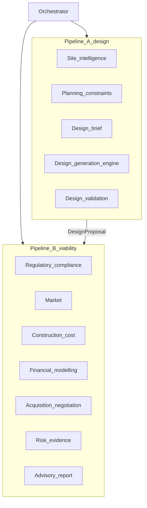

# Architecture — engines, modules, agents, configuration

**Principle:** Specialists and LLMs **interpret, investigate, and challenge**. Deterministic **engines** own measurable outputs. **Modules** own state and boundaries. **Configuration packs** customise behaviour without forking core logic.

Aligned with EpiCare async AI patterns: Convex jobs, Mastra webhooks, `dispatchAgentWorkflow` + polling UI ([EpiCare `mastra-async-ops`](https://github.com/bkb-Git/epi-care/blob/main/.cursor/rules/mastra-async-ops.mdc)).

---

## Layer diagram

---

## Deterministic engines

Engines are **pure services**: versioned inputs → versioned outputs → stored calculation ledger. Unit-tested; no LLM in the numeric path.

| Engine | Input | Output | Prohibited behaviour |
|--------|-------|--------|----------------------|
| **Physical envelope** | Parcel geometry, constraint set | Max footprint, GFA ceiling, parking cap, amenity area budget | Infer density from neighbours |
| **Planning constraint** | County pack + parcel jurisdiction | Machine-readable setbacks, PR, coverage, height, parking rules | Guess permits from adjacent uses |
| **Design optimisation** | Site model, brief, templates | Pareto candidate designs (unit mix, footprints) | LLM-invented areas |
| **Geometry worker** | Optimisation result | IFC, GeoJSON, GLB, raster previews | Synchronous blocking in API routes |
| **IFC quantity extractor** | IFC asset | NSA, GFA, unit counts, parking counts | Vision-LLM on floor plans for quantities |
| **Construction cost** | Quantities, spec tier, rate library | TDC breakdown, contingency lines | Unsourced KSh/sqm |
| **Financial appraisal** | Costs, revenues, schedule, funding | GDV, profit, IRR, NPV, DSCR, cash peaks | Embedded in finance **agent** |
| **Residual / acquisition** | Fin model, market comps | Market, residual, entry, ceiling (labeled) | Entry price as “valuation” |
| **Regulatory rule check** | Proposal metrics, rule set | Pass/fail/unknown per rule ID | Legal certification |
| **Evidence / confidence** | Evidence graph, weights | Dimension scores, hard stops, question queue | Single blended “AI confidence” |

### Calculation dependency graph

When **land cost**, **permitted density**, or **unit mix** changes, dependent artefacts must invalidate or recalculate in order:

---

## Domain modules

Modules expose APIs to the dashboard, Convex mutations, and agents. They **persist state** and **invoke engines**; they do not embed financial formulas in agent prompts.

| Module | Responsibilities | Primary storage |
|--------|------------------|-----------------|
| **Project & parcel** | Projects, parcels, title/survey refs, geometry refs, acquisition context | Convex + object storage; PostGIS adjunct R3+ |
| **Regulatory knowledge** | Rule records, document ingestion, RAG chunks, verification status | Convex + `@convex-dev/rag` pattern |
| **Market evidence** | Listings, comps, rents, absorption; asking vs transacted typing | Convex |
| **Design proposal registry** | Versioned proposals, assets, validation status, immutability rules | Convex + S3-compatible storage |
| **Commercial events** | Negotiation ledger, extracted entities, reconciliation status | Convex (append-only events) |
| **Viability runs** | Links `proposalVersionId` + `assumptionBundleId` → frozen engine outputs | Convex |
| **Report** | Report templates, PDF/HTML, provenance links | Convex + export pipeline |
| **Document ingest** | OCR/PDF/DOCX extraction (reuse `@epicare/document-extract` patterns) | Convex jobs |

---

## Specialist agents (Mastra)

Agents run **async** (T1/T2). They call tools that read/write modules and **request engine runs**; they never replace engines for arithmetic.

| Agent | Pipeline | Core behaviours |
|-------|----------|-----------------|
| **Development orchestrator** | A + B | Stage gates, job routing, dependency checks, decision class |
| **Land** | A (early), B | Title/survey interpretation, gap analysis, acquisition context |
| **Legal** | A, B | Rule retrieval, plain-language explanation, professional escalation |
| **Market** | B | Comp selection narrative, demand story, absorption challenges |
| **Planning** | A | Amenity/walkability objectives, brief refinement, allocation trade-offs |
| **Design brief** | A | Developer intent → structured brief against templates |
| **Comms** | B (acquisition) | Extract events; never overwrite historical prices |
| **Cost** | B | Explain BOQ; flag QS validation needs |
| **Finance** | B | Scenario narration; all figures from FinEng |
| **Risk** | B | Contradictions, sensitivity framing, question prioritisation |

Optional **environmental design** worker (Ladybug/E+) sits after design validation in Pipeline A—deterministic indicators, agent explains trade-offs.

### Orchestrator vs pipelines

Pipeline B **must not** invoke design regeneration when only financial or market assumptions change.

---

## Configurable packs

Configuration is **data**, shipped as versioned packs (JSON/YAML in `packages/pdi-config` when implemented—not in this docs-only phase).

| Pack | Contents | Who edits |
|------|----------|-----------|
| **Property ontology** | Hierarchical development types, default metrics per type | Product + planner advisor |
| **County rule packs** | Rules with jurisdiction, effective dates, sources | Legal/planner curation |
| **Rate libraries** | Construction rates by location, spec, date, source, confidence | QS advisor + ingestion |
| **Market indices** | Location bands, default absorption bands (placeholder until data) | Research |
| **Financial presets** | Interest, drawdown curves, off-plan schedules, hurdle rates | User/org |
| **Confidence weights** | Dimension weights, hard-stop rule IDs | Product default; org override later |
| **Design templates** | Typology parameters for optimisation (courtyard, podium, etc.) | Architecture advisor |
| **Feature flags** | R1–R4 capability gates | Engineering |

---

## Development decision engine

Sits above viability runs:

| Input | Processing | Output |
|-------|------------|--------|
| One or more viability snapshots | Compare scenarios, apply hard stops, merge acquisition intel | `Recommendation` enum + conditions list |
| Evidence confidence | Gate “proceed” if below threshold | `Insufficient evidence` path |
| User constraints | Max land price, target IRR, timeline | Filter and rank scenarios |

The finance engine **may reject a design**: high aesthetic / low return concepts are not auto-recommended.

---

## Design principles (data architecture)

1. **Every fact has provenance** — source, date, verification level.  
2. **Every calculation has dependencies** — stored in calculation ledger.  
3. **Separate fact, assumption, derived** — never interchangeable types.  
4. **Version everything** — proposals, assumption bundles, reports.  
5. **Rules are jurisdiction-aware** — geography + effective date on every requirement.  

See [ONTOLOGY.md](./ONTOLOGY.md) and [DESIGN_PROPOSAL_CONTRACT.md](./DESIGN_PROPOSAL_CONTRACT.md).

---

## Intelligence domain map (conceptual)

Matches product scope “eight domains” to implementation layers:

| Intelligence domain | Module(s) | Engine(s) | Agent(s) |
|----------------------|-----------|-----------|----------|
| Land | Project & parcel | Residual (partial) | Land, Comms |
| Regulatory | Regulatory knowledge | Rule check, Planning constraint | Legal |
| Market | Market evidence | Financial (revenue inputs) | Market |
| Urban planning | Config templates | Physical envelope, Design optimisation | Planning, Design brief |
| Development design | Design registry | Design, Geometry, IFC | Planning, Orchestrator |
| Cost | Viability | Construction cost | Cost |
| Financial | Viability | Financial, Residual | Finance |
| Risk | Viability, Report | Confidence | Risk, Orchestrator |

---

## Related documents

- [PIPELINES.md](./PIPELINES.md)  
- [TECH_STACK.md](./TECH_STACK.md)  
- [DATA_SOURCES.md](./DATA_SOURCES.md)  
