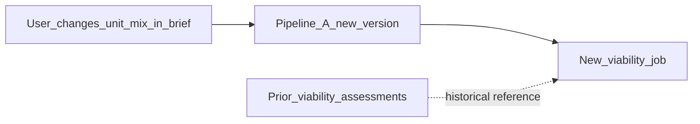

# Design proposal contract

The **semantic contract** between Pipeline A (design) and Pipeline B (viability). Financial and regulatory engines consume this object—not raw Blender binaries or LLM descriptions.

---

## Design principles

1. **Two layers:** geometry assets (IFC, GeoJSON, GLB) + semantic metrics (JSON).  
2. **Versioned and immutable:** viability runs pin `proposalId` + `version`; edits create new versions.  
3. **Quantities from extraction:** GFA/NSA/unit counts from IFC extractor or geometry worker, with calculation ledger refs.  
4. **Validation status** explicit: `preliminary | validated | failed`.  
5. **Provenance** on every metric: `fact | derived` with `derivationId`.

---

## Versioning rules

| Event | Action |
|-------|--------|
| User edits brief or regenerates layout | Increment `version`; prior versions retained |
| Viability job starts | Target version becomes **read-only** for that assessment |
| Assumption change only | New viability job; **same** proposal version |
| IFC re-export with same semantics | Bump `geometryHash`; may keep version if metrics unchanged |

---

## Core types (illustrative JSON)

### `DesignProposal`

```json
{
  "proposalId": "PROP-001",
  "version": 1,
  "projectId": "PRJ-001",
  "parcelId": "PARCEL-001",
  "developmentType": "residential_apartments",
  "ontologyPath": ["Residential", "MultiFamily", "Apartments", "MidMarket"],
  "createdAt": "2026-11-10T12:00:00Z",
  "geometryHash": "sha256:…",
  "validationStatus": "preliminary",
  "siteMetrics": {
    "plotAreaM2": 2000,
    "buildingFootprintM2": 700,
    "openSpaceM2": 650,
    "internalRoadsM2": 300
  },
  "buildingMetrics": {
    "blocks": 1,
    "floors": 5,
    "grossFloorAreaM2": 3500,
    "netSaleableAreaM2": 2800,
    "commonAreaM2": 420,
    "parkingSpaces": 30,
    "parkingType": "surface"
  },
  "unitMix": [
    {
      "unitTypeId": "one_bedroom",
      "count": 10,
      "averageAreaM2": 55,
      "totalSaleableAreaM2": 550
    },
    {
      "unitTypeId": "two_bedroom",
      "count": 20,
      "averageAreaM2": 85,
      "totalSaleableAreaM2": 1700
    }
  ],
  "amenities": [
    { "type": "central_green", "areaM2": 400 },
    { "type": "play_area", "areaM2": 120 }
  ],
  "commercialGroundFloor": {
    "present": false,
    "gfaM2": 0
  },
  "designAssets": {
    "sitePlanGeoJson": "s3://…/site-plan.geojson",
    "floorPlansIfc": "s3://…/building.ifc",
    "massingGlb": "s3://…/massing.glb",
    "previewPng": "s3://…/preview.png"
  },
  "constraintsChecked": [
    {
      "ruleId": "KE-NBI-ZONE-001",
      "result": "pass",
      "engineRunId": "RUN-PLAN-42"
    }
  ],
  "assumptions": [
    {
      "assumptionId": "ASM-DES-01",
      "statement": "Plot boundary from uploaded survey plan",
      "evidenceId": "EVD-102"
    }
  ],
  "derivations": [
    {
      "derivationId": "DER-NSA-01",
      "metric": "buildingMetrics.netSaleableAreaM2",
      "method": "ifcopenshell_spaces_aggregate",
      "engineRunId": "RUN-IFC-7"
    }
  ]
}
```

### `AssumptionBundle` (Pipeline B input)

```json
{
  "assumptionBundleId": "ASM-BND-001",
  "projectId": "PRJ-001",
  "landPriceKes": 12000000,
  "acquisitionCostsKes": 800000,
  "financePresetId": "dev_loan_standard_2026",
  "marketBandId": "ruaka_apartments_mid_2026",
  "costSpecTier": "mid_market",
  "scheduleMonths": 24,
  "strategy": "build_to_sell",
  "offPlanScheduleId": null,
  "hurdleIrrPercent": 18
}
```

### `ViabilityAssessment` (Pipeline B output summary)

```json
{
  "assessmentId": "VIA-001",
  "proposalId": "PROP-001",
  "proposalVersion": 1,
  "assumptionBundleId": "ASM-BND-001",
  "feasibilityScore": 72,
  "evidenceConfidenceScore": 68,
  "recommendation": "conditional",
  "hardStops": [],
  "financialSummary": {
    "gdvKes": 120000000,
    "totalDevelopmentCostKes": 98000000,
    "profitKes": 22000000,
    "profitOnCostPercent": 22.4,
    "irrPercent": 19.1,
    "peakCashDeficitKes": 0
  },
  "acquisitionSummary": {
    "askingPriceKes": 18000000,
    "recommendedEntryKes": 12000000,
    "maximumAcquisitionKes": 13000000,
    "negotiationRequired": true
  },
  "engineRunIds": ["RUN-FIN-3", "RUN-COST-2", "RUN-CONF-1"],
  "reportArtifactId": "RPT-001"
}
```

---

## IFC requirements

IFC is the **interchange format** for quantities Pipeline B trusts.

Minimum extractable entities:

- Count of residential units by type  
- Gross floor area (by use)  
- Net internal / saleable area per unit type  
- Parking object count  
- Common area totals  

Extraction via **IfcOpenShell** in the Python worker; store `engineRunId` on each aggregated metric.

**Do not** use vision models on plan images as the primary quantity source.

---

## GeoJSON requirements

Site plan layer:

- Parcel boundary (EPSG:4326 or project CRS documented)  
- Building footprints  
- Open space polygons  
- Access points and internal roads (optional R3)  

Used for maps, amenity scoring, and constraint visualization—not for replacing survey area for legal area.

---

## Zod / TypeScript placement (future)

When implemented in the monorepo:

- `packages/pdi-contracts` — Zod schemas + types shared by dashboard and Convex validators  
- Convex tables store canonical JSON matching schema version field `contractVersion: 1`  

---

## Reconciliation: design change → finance



Prior assessments remain queryable for audit; reports reference exact `proposalVersion` and `assumptionBundleId`.

---

## Related documents

- [PIPELINES.md](./PIPELINES.md)  
- [ONTOLOGY.md](./ONTOLOGY.md)  
- [ARCHITECTURE.md](./ARCHITECTURE.md)  
