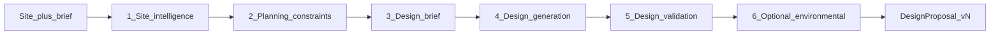
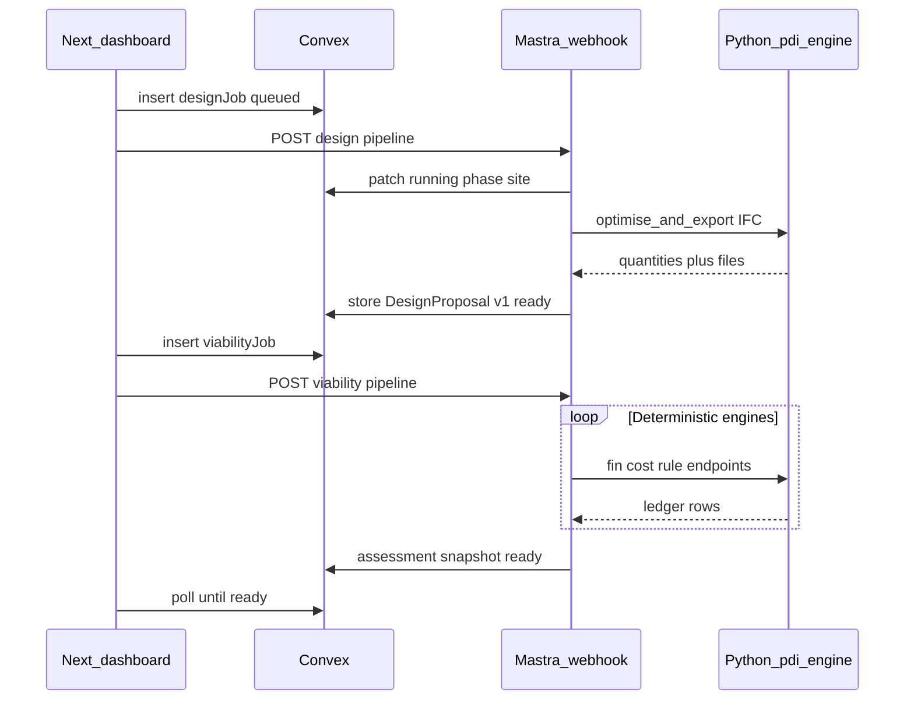

# Pipelines — design generation vs development viability

Two **independently executable** pipelines share the property ontology but not execution coupling. Pipeline B consumes a **frozen semantic** `DesignProposal`; it does not depend on how geometry was produced.

---

## Why split?

| Benefit | Explanation |
|---------|-------------|
| **Reusable designs** | Evaluate designs A/B/C/D with the same land price and finance assumptions |
| **Clear ownership** | Design engine produces quantities; viability engine consumes them |
| **Replaceable geometry** | Swap Blender worker for TestFit MCP without rewriting finance |
| **Async boundaries** | Long geometry jobs do not block viability reruns |
| **Financial veto** | Viability can reject designs without regenerating layouts |

---

## Pipeline A — Design generation

**Trigger:** `designJobs` (Convex) → orchestrator stages → optional Python geometry worker.

### Stages

| Step | Owner | Engine / agent | Output artefact |
|------|-------|----------------|-----------------|
| 1. Site intelligence | Land module + agent | GIS worker (GeoPandas/QGIS) optional | `SiteModel` |
| 2. Planning constraints | Regulatory module | Planning constraint engine | `ConstraintSet` |
| 3. Design brief | Config + agent | — | `DesignBrief` |
| 4. Design generation | Design registry | Design optimisation + geometry worker | Candidate layouts + IFC/GeoJSON |
| 5. Design validation | Design registry | Rule engine (preliminary) + Topologic checks | `validation_status` |
| 6. Environmental (optional) | — | Ladybug/indicators worker | Environmental summary attachment |

**Success criterion:** `DesignProposal` semantic JSON + assets; all areas traceable to geometry extraction—not LLM estimates.

### Pipeline A inputs

- Parcel boundary (or best available approximation with confidence penalty)
- `ConstraintSet` for jurisdiction
- `DesignBrief` (use type, mix preferences, amenity targets)
- Design template ID from config pack

### Pipeline A outputs

See [DESIGN_PROPOSAL_CONTRACT.md](./DESIGN_PROPOSAL_CONTRACT.md).

---

## Pipeline B — Development viability

**Trigger:** `viabilityJobs` with `proposalId` + `proposalVersion` + `assumptionBundleId`.

```mermaid
flowchart LR
  In[DesignProposal_plus_assumptions]
  V1[6_Regulatory_compliance]
  V2[7_Market]
  V3[8_Construction_cost]
  V4[9_Financial_modelling]
  V5[10_Acquisition]
  V6[11_Risk_evidence]
  V7[12_Advisory_report]
  Out[ViabilityAssessment]

  In --> V1 --> V2 --> V3 --> V4 --> V5 --> V6 --> V7 --> Out
```

### Stages

| Step | Owner | Notes |
|------|-------|-------|
| 6. Regulatory compliance | Rule engine + legal agent | Measurable checks on proposal metrics; unknown → flags |
| 7. Market | Market module + agent | Revenue and absorption assumptions with provenance |
| 8. Construction cost | Cost engine | Quantities from proposal × rate library |
| 9. Financial modelling | Fin engine | Build-to-sell/hold/mixed; cash shortfall detection |
| 10. Acquisition | Residual engine + comms | Three price types; negotiation memo |
| 11. Risk / evidence | Conf engine + risk agent | Hard stops; question queue |
| 12. Advisory report | Report module | PDF/HTML + scenario comparison |

**Pipeline B never calls** design optimisation or geometry worker unless the user explicitly starts a **new** Pipeline A job.

---

## Job contracts (EpiCare-style)

### `designJobs`

| Field | Purpose |
|-------|---------|
| `projectId`, `orgId`, `createdBy` | Tenancy |
| `status` | `queued \| running \| ready \| failed` |
| `phase` | e.g. `site`, `constraints`, `generate`, `validate` |
| `briefId`, `templateId` | Config refs |
| `result.proposalId`, `result.version` | On success |
| `errorCode` | Stable codes for UI |

Webhook: `POST /api/agents/pdi-design` (future) → `dispatchAgentWorkflow` → Python worker callback → Convex patch.

### `viabilityJobs`

| Field | Purpose |
|-------|---------|
| `proposalId`, `proposalVersion` | Immutable design snapshot |
| `assumptionBundleId` | Finance/market/cost assumptions version |
| `result.assessmentId` | Frozen outputs |
| `phase` | `compliance`, `cost`, `finance`, `risk`, `report` |

Rerunning viability with a **new** `assumptionBundleId` on the **same** proposal version is the normal sensitivity-analysis path.

---

## Sequence (runtime)

LLM steps (explanation, questions, comp narrative) run inside Mastra between engine calls; engines return JSON numbers only.

---

## Multi-scenario workflow

1. Run Pipeline A once per template **or** once with Pareto set → proposals `v1a`, `v1b`, `v1c`.  
2. User selects scenarios to compare.  
3. Run Pipeline B in parallel jobs sharing `assumptionBundleId`.  
4. Report module ranks by risk-adjusted return **and** evidence confidence.  

---

## MVP build order

| Stage | Build | Criterion |
|-------|-------|-----------|
| 1 | Site ingestion + parcel model | Boundary, dimensions, access |
| 2 | Planning constraint engine v1 | Rules with source + jurisdiction |
| 3 | Parametric design generator | Three layout options |
| 4 | IFC/GeoJSON export + registry | Metrics without visual interpretation |
| 5 | Compliance validation flags | Known violations surfaced |
| 6 | Financial engine | Independent per proposal |
| 7 | Market, cost, comms agents | Replace placeholder assumptions |

---

## Related documents

- [DESIGN_PROPOSAL_CONTRACT.md](./DESIGN_PROPOSAL_CONTRACT.md)  
- [ARCHITECTURE.md](./ARCHITECTURE.md)  
- [TECH_STACK.md](../engineering/TECH_STACK.md)  
