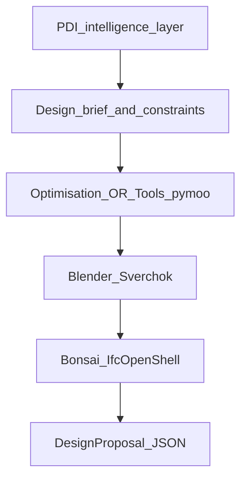

# Open-source design stack vs paid platforms

PDI should **own development intelligence** and use geometry/BIM tools as **engines** behind the `DesignProposal` contract. Default path: **open source**. Paid tools are optional integration tiers for speed or customer demand.

---

## Capability comparison

| Capability | Open-source option | Paid alternative | Assessment |
|------------|-------------------|------------------|------------|
| Parametric 3D / scripting | FreeCAD | Autodesk Revit | FreeCAD strong for scripted geometry; BIM maturity lower than Revit |
| BIM authoring / IFC | Bonsai + IfcOpenShell | Revit, Archicad | Best OSS BIM path; Bonsai Studio UX still maturing |
| Procedural massing | Blender + Sverchok | TestFit, Rhino/Grasshopper | Flexible; you build rule libraries |
| Spatial topology | TopologicPy | Proprietary CD tools | Good for adjacency / connectivity checks |
| GIS / parcel | QGIS + PostGIS | ArcGIS | Excellent for Kenya parcel workflow |
| Environmental | Ladybug Tools (+ EnergyPlus) | Autodesk Forma, ClimateStudio | Strong OSS environmental path |
| Energy simulation | EnergyPlus + OpenStudio | IES VE, DesignBuilder | Later-stage, not MVP |
| Urban raster analysis | GRASS GIS | ArcGIS Urban | Terrain/suitability |
| 2D plan editing | OpenPlan3D | Floorplanner | Lightweight only |
| Site feasibility UX | **Custom (PDI)** | TestFit, Archistar | Gap is productised rules + finance link |
| Development finance | **Custom Python FinEng** | ARGUS Developer | ARGUS benchmark for appraisal math |

---

## Recommended OSS combination (default)

| Role | Stack |
|------|--------|
| GIS and site intelligence | QGIS, PostGIS, GeoPandas |
| Procedural geometry | Blender, Sverchok, Python |
| Spatial relationships | TopologicPy |
| BIM export and quantities | Bonsai, IfcOpenShell |
| Optimisation | OR-Tools, pymoo |
| Environmental (R3+) | Ladybug Tools |

### Paid → OSS mapping

| Paid product | OSS substitute |
|--------------|----------------|
| TestFit | QGIS/PostGIS + Blender/Sverchok + custom optimisation + PDI finance |
| Archistar | QGIS + planning rule engine + Blender/Bonsai |
| Autodesk Forma | QGIS + Blender + Ladybug |
| Finch 3D | TopologicPy + Sverchok + custom layout rules |
| ARGUS Developer | PDI financial engine (deterministic Python) |

**Main gap:** prebuilt architectural rule libraries, polished UX, and years of workflow refinement in commercial products—not raw inability to produce geometry.

---

## Integration stance: paid optional tier

| Tier | Tools | When |
|------|-------|------|
| **T0 — OSS only** | Blender, IfcOpenShell, QGIS | MVP, funding demo, cost control |
| **T1 — TestFit MCP/API** | Site planning, parking, DXF | Customer requires TestFit output |
| **T2 — Autodesk Forma** | Environmental massing | Premium environmental narrative |
| **T3 — Revit export** | Professional handoff | Architect workflow; not generation core |

Imports must still pass through **IFC/GeoJSON contract** and quantity extractor—never bypass semantic layer.

---

## Design orchestration (conceptual)

**Financial engine can reject designs** produced by any tier.

---

## What conceptual deliverables include (not construction drawings)

- Site boundary and footprints  
- Conceptual masterplan  
- Massing and floor plates  
- Unit distribution and parking  
- Green space / amenity allocation  
- GFA, NSA, 3D previews  
- Preliminary specification tier assumptions  

NCA and county approvals still require registered consultants and approved drawings.

---

## Headless operation

Geometry tools run in **worker containers**, not on the Next.js server:

- Triggered from Mastra webhook  
- Progress via Convex job phases  
- Artefacts to object storage  
- Callback patches proposal registry  

---

## Related documents

- [DESIGN_PROPOSAL_CONTRACT.md](../architecture/DESIGN_PROPOSAL_CONTRACT.md)  
- [TECH_STACK.md](../engineering/TECH_STACK.md)  
- [PIPELINES.md](../architecture/PIPELINES.md)  
